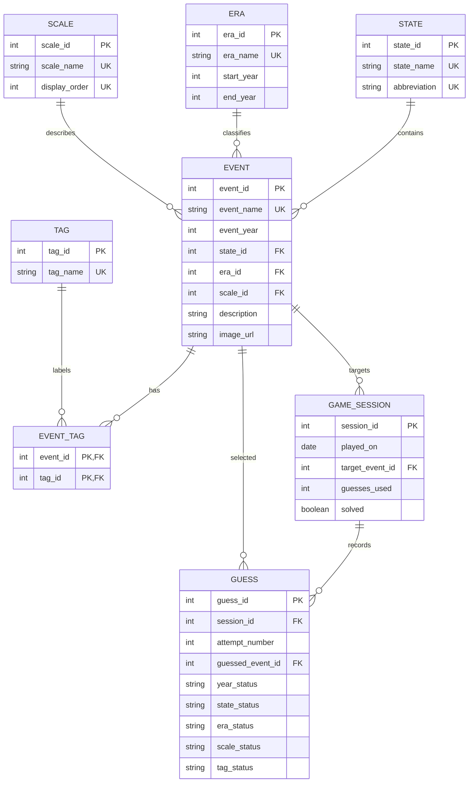

# Check In 2: Normalization and Architectural Evolution

*Due November 1st*

**Focus: Normalization up to 3NF, anomaly resolution, ER modeling, and data integrity.**

## What changed since Check-in 1

In the first check-in, I planned on having five tables:

EVENT, STATE, ERA, SCALE, and TAG

That design made sense for the first version of the game, but it had a few problems once I started thinking about the app more seriously. The biggest problem was that an event could only have one tag. I also had nowhere to save which event was the target for a round or what guesses the player made.

For this check-in, I expanded the database to include:

- The historical event catalog and its reusable category values.
- Multiple tags for an event through a separate relationship table.
- Anonymous game sessions and the guesses made during each session.
- Integrity rules to prevent duplicate names, invalid category references, and
  duplicate attempt numbers.

The frontend currently has 29 in-memory events in `src/game/mock-events.ts`. The backend seed command has 60 events, including the five events from the original prototype. The Expo app is still using the in-memory repository for now. Connecting the mobile app to the backend is planned for Check-in 3. I am also leaving accounts, authentication, long-term statistics, and streaks for later. A game session can be created without a user table, and adding a user table later should not require changing the event catalog.

## Schema evolution

The original design placed one foreign key for each category directly on the EVENT table. That worked while every event had exactly one tag, but it does not work as well if an event needs multiple tags. It also mixes the event catalog with information about a particular game round.

The updated design keeps the original lookup tables and adds three relations:

| New relation | Why I added it |
| --- | --- |
| EVENT_TAG | Allows an event to have multiple tags without repeating the event row. |
| GAME_SESSION | Saves the date, target event, and result of a game round. |
| GUESS | Saves the event selected and the attempt number for each guess. |

The current UI can still display the first or primary tag in its event card. The difference is that the database is no longer forced to throw away other tags if I add them later.

### Entity-Relationship diagram



The main relationships are:

- One STATE can be connected to many EVENT rows.
- One ERA can be connected to many EVENT rows.
- One SCALE can be connected to many EVENT rows.
- EVENT and TAG have a many-to-many relationship through EVENT_TAG.
- One EVENT can be the target of many GAME_SESSION rows.
- One GAME_SESSION can have many GUESS rows.
- Each GUESS points to the EVENT selected by the player.

## Normalization demonstration

To keep the examples consistent, I used the same five events from the prototype throughout the normalization steps:

| Event | Year | State | Era | Scale | Tag |
| --- | ---: | --- | --- | --- | --- |
| California Gold Rush | 1849 | California | National Expansion | International | Migration |
| Declaration of Independence | 1776 | Pennsylvania | American Revolution | International | Politics |
| Battle of Gettysburg | 1863 | Pennsylvania | Civil War | National | Military |
| Moon Landing | 1969 | Florida | Modern Era | International | Science |
| Louisiana Purchase | 1803 | Louisiana | New Nation | International | Expansion |

These are the same basic facts used by the current prototype. The first version of the UI only represents one tag per event, but the new database design is ready for more than one.

### Starting relation: early unnormalized design

An early version could have stored everything in one large table:

`EVENT_RECORD(event_id, event_name, event_year, state_id, state_name, state_abbreviation, era_id, era_name, era_start_year, era_end_year, scale_id, scale_name, tag_id, tag_name, description, image_url)`

This would put the event information and all of the lookup descriptions in the same row. It is easy to understand at first, but it creates repeated data. For example, Pennsylvania would be copied into every event that happened there. The original five-table design improved this by separating STATE, ERA, SCALE, and TAG. However, the original EVENT table still had one `tag_id`, so it could not properly represent multiple tags.

### First Normal Form (1NF)

To get to 1NF, every field should contain one atomic value, and every row should describe one event. The relation would look like this:

`EVENT_1NF(event_id, event_name, event_year, state_id, state_name, state_abbreviation, era_id, era_name, era_start_year, era_end_year, scale_id, scale_name, tag_id, tag_name, description, image_url)`

| event_id | event_name | event_year | state_id | state_name | era_id | era_name | scale_id | scale_name | tag_id | tag_name |
| ---: | --- | ---: | ---: | --- | ---: | --- | ---: | --- | ---: | --- |
| 1 | California Gold Rush | 1849 | 1 | California | 4 | National Expansion | 5 | International | 1 | Migration |
| 2 | Declaration of Independence | 1776 | 2 | Pennsylvania | 2 | American Revolution | 5 | International | 2 | Politics |
| 3 | Battle of Gettysburg | 1863 | 2 | Pennsylvania | 5 | Civil War | 4 | National | 3 | Military |
| 4 | Moon Landing | 1969 | 3 | Florida | 9 | Modern Era | 5 | International | 4 | Science |
| 5 | Louisiana Purchase | 1803 | 4 | Louisiana | 3 | New Nation | 5 | International | 5 | Expansion |

Every value in this table is atomic, so this version meets 1NF. Since there is only one tag per event in this sample, `event_id` can be used as the candidate key. The problem appears when I support multiple tags. If I repeat the event row for each tag, the key would become `(event_id, tag_id)`. That would mean all the event details get repeated every time another tag is added.

### Second Normal Form (2NF)

The one-tag version is already in 2NF because its key is only `event_id`. There are no partial dependencies when the key has only one column. I did not skip 2NF; the result for this specific sample is that it already satisfies 2NF. However, the future multi-tag version has a composite key of `(event_id, tag_id)`. In that version:

- `event_name`, `event_year`, `state_id`, `era_id`, `scale_id`, `description`,
  and `image_url` depend only on `event_id`.
- `tag_name` depends only on `tag_id`.
- The association between an event and a tag depends on both `event_id` and
  `tag_id`.

The first two groups are partial dependencies because they depend on only part of the composite key. To remove those dependencies, I separated the event details, tag details, and event-tag relationship:

```text
EVENT_2NF(
  event_id PK, event_name, event_year, state_id, era_id, scale_id,
  description, image_url
)

TAG_2NF(tag_id PK, tag_name)

EVENT_TAG_2NF(
  event_id PK/FK, tag_id PK/FK
)
```

For the current sample, every event has one EVENT_2NF row and one EVENT_TAG_2NF row. If I add another tag later, I only need to insert another EVENT_TAG_2NF row. I do not have to duplicate the event name, year, state, or description.

At this point, the partial dependencies are fixed. However, if the descriptive lookup columns from the original table are still stored in EVENT_2NF, there are still transitive dependencies. For example, `state_name` is really determined by `state_id`, not directly by `event_id`. Removing those dependencies is the next step.

### Third Normal Form (3NF)

To reach 3NF, I moved each reusable concept into its own table:

```text
STATE(state_id PK, state_name UK, abbreviation UK)
ERA(era_id PK, era_name UK, start_year, end_year)
SCALE(scale_id PK, scale_name UK, display_order UK)
TAG(tag_id PK, tag_name UK)
EVENT(
  event_id PK, event_name UK, event_year, state_id FK,
  era_id FK, scale_id FK, description, image_url
)
EVENT_TAG(event_id PK/FK, tag_id PK/FK)
```

For example, `state_id = 2` represents Pennsylvania. The Declaration of Independence and the Battle of Gettysburg can both reference that one STATE row. The spelling and abbreviation do not need to be copied into both EVENT rows. The same idea applies to ERA and SCALE. `era_name`, `start_year`, and `end_year` describe an era, so they belong in ERA instead of being repeated for every event in that era.

The gameplay tables are also separate from the event catalog:

```text
GAME_SESSION(session_id PK, played_on, target_event_id FK, guesses_used, solved)
GUESS(
  guess_id PK, session_id FK, attempt_number, guessed_event_id FK,
  year_status, state_status, era_status, scale_status, tag_status
)
```

The session ID determines the information about a game round. The guess ID determines the information about one recorded guess. The unique constraint on `(session_id, attempt_number)` makes sure that the same round cannot have two different guesses with the same attempt number.

The statuses in GUESS are a snapshot of the feedback shown for that attempt. They are not copies of the event's category descriptions, so they do not create another dependency inside EVENT.

## Functional dependencies

These are the main functional dependencies I used while designing the tables:

```text
event_id -> event_name, event_year, state_id, era_id, scale_id, description, image_url
state_id -> state_name, abbreviation
era_id -> era_name, start_year, end_year
scale_id -> scale_name, display_order
tag_id -> tag_name
(event_id, tag_id) -> no additional descriptive attributes
session_id -> played_on, target_event_id, guesses_used, solved
guess_id -> session_id, attempt_number, guessed_event_id, all five statuses
(session_id, attempt_number) -> guess_id, guessed_event_id, all five statuses
```

The first dependency shows why the event details belong in EVENT. The next four show why the state, era, scale, and tag descriptions belong in their own lookup tables. The `(event_id, tag_id)` dependency explains why EVENT_TAG is only an association table. It does not need to store another copy of the event or tag name.

The Django implementation gives EVENT_TAG an automatic `id` column as well. The pair `(event_id, tag_id)` is still the unique business key because the database prevents the same event-tag pair from being inserted twice.

The final dependencies explain why I kept GAME_SESSION and GUESS separate. A target event is a fact about one round, while the event itself is a permanent catalog fact.

## Anomalies in the early design

### Update anomaly

In the all-in-one table, Pennsylvania appears in both the Declaration of Independence row and the Battle of Gettysburg row. If the spelling or abbreviation for Pennsylvania needed to be corrected, every matching event row would need to be updated.

If I forgot to update one row, the database would contain two different versions of Pennsylvania. In the 3NF design, I update the one row in STATE and all events automatically reference the corrected value.

### Insertion anomaly

In the first design, I could not add a new tag such as `Civil Rights` unless I also had an event using that tag. The tag name was stored inside an event row, so a tag could not exist by itself.

With the separate TAG table, I can insert `Civil Rights` before any event is associated with it. The same idea applies to the other lookup tables. I can seed valid states, eras, and scales even before the event catalog is full.

### Deletion anomaly

If Moon Landing were the only event with the `Science` tag, deleting Moon Landing from the all-in-one table would also delete the only record that Science is a valid tag.

In the normalized design, deleting the event removes its EVENT_TAG association, but the `Science` row stays in TAG. The database does not lose the fact that Science is a valid category.

### Gameplay anomaly

The original event catalog does not know which event was the target of a particular round. It also cannot reliably tell me what event was guessed on attempt 3 or how many guesses the player used.

I could put guess columns directly into EVENT, but that would mix permanent catalog facts with temporary game-round facts. GAME_SESSION and GUESS keep those responsibilities separate. This also gives me a better foundation for future statistics without denormalizing the event catalog.

## Integrity constraints and representative SQL

The database needs more than just separate tables. It also needs rules that prevent bad data. The main rules are:

- Names and abbreviations should be unique.
- Foreign keys should point to existing category and event rows.
- An era cannot end before it starts.
- An event-tag pair cannot be duplicated.
- A session can have no more than 15 guesses.
- An attempt number must be between 1 and 15.
- Feedback statuses must be `correct`, `close`, or `incorrect`.

This is the representative SQL schema:

```sql
CREATE TABLE State (
    state_id INTEGER PRIMARY KEY,
    state_name VARCHAR(50) NOT NULL UNIQUE,
    abbreviation CHAR(2) NOT NULL UNIQUE
);

CREATE TABLE Era (
    era_id INTEGER PRIMARY KEY,
    era_name VARCHAR(100) NOT NULL UNIQUE,
    start_year INTEGER NOT NULL,
    end_year INTEGER NOT NULL,
    CHECK (start_year <= end_year)
);

CREATE TABLE Scale (
    scale_id INTEGER PRIMARY KEY,
    scale_name VARCHAR(30) NOT NULL UNIQUE,
    display_order INTEGER NOT NULL UNIQUE CHECK (display_order > 0)
);

CREATE TABLE Tag (
    tag_id INTEGER PRIMARY KEY,
    tag_name VARCHAR(50) NOT NULL UNIQUE
);

CREATE TABLE Event (
    event_id INTEGER PRIMARY KEY,
    event_name VARCHAR(100) NOT NULL UNIQUE,
    event_year INTEGER NOT NULL,
    state_id INTEGER NOT NULL,
    era_id INTEGER NOT NULL,
    scale_id INTEGER NOT NULL,
    description TEXT NOT NULL,
    image_url VARCHAR(200),
    FOREIGN KEY (state_id) REFERENCES State(state_id),
    FOREIGN KEY (era_id) REFERENCES Era(era_id),
    FOREIGN KEY (scale_id) REFERENCES Scale(scale_id)
);

CREATE TABLE EventTag (
    event_id INTEGER NOT NULL,
    tag_id INTEGER NOT NULL,
    PRIMARY KEY (event_id, tag_id),
    FOREIGN KEY (event_id) REFERENCES Event(event_id) ON DELETE CASCADE,
    FOREIGN KEY (tag_id) REFERENCES Tag(tag_id) ON DELETE RESTRICT
);

CREATE TABLE GameSession (
    session_id INTEGER PRIMARY KEY,
    played_on DATE NOT NULL,
    target_event_id INTEGER NOT NULL,
    guesses_used INTEGER NOT NULL DEFAULT 0
        CHECK (guesses_used BETWEEN 0 AND 15),
    solved BOOLEAN NOT NULL DEFAULT FALSE,
    FOREIGN KEY (target_event_id) REFERENCES Event(event_id)
);

CREATE TABLE Guess (
    guess_id INTEGER PRIMARY KEY,
    session_id INTEGER NOT NULL,
    attempt_number INTEGER NOT NULL CHECK (attempt_number BETWEEN 1 AND 15),
    guessed_event_id INTEGER NOT NULL,
    year_status VARCHAR(9) NOT NULL
        CHECK (year_status IN ('correct', 'close', 'incorrect')),
    state_status VARCHAR(9) NOT NULL
        CHECK (state_status IN ('correct', 'close', 'incorrect')),
    era_status VARCHAR(9) NOT NULL
        CHECK (era_status IN ('correct', 'close', 'incorrect')),
    scale_status VARCHAR(9) NOT NULL
        CHECK (scale_status IN ('correct', 'close', 'incorrect')),
    tag_status VARCHAR(9) NOT NULL
        CHECK (tag_status IN ('correct', 'close', 'incorrect')),
    UNIQUE (session_id, attempt_number),
    FOREIGN KEY (session_id) REFERENCES GameSession(session_id) ON DELETE CASCADE,
    FOREIGN KEY (guessed_event_id) REFERENCES Event(event_id)
);
```

For a multi-tag comparison, the application can find tags shared by the guessed event and the target event with a join:

```sql
SELECT t.tag_name
FROM EventTag AS et
JOIN Tag AS t ON t.tag_id = et.tag_id
WHERE et.event_id = :guessed_event_id
INTERSECT
SELECT t.tag_name
FROM EventTag AS et
JOIN Tag AS t ON t.tag_id = et.tag_id
WHERE et.event_id = :target_event_id;
```

## Troubleshooting and reflection

The main problem I ran into was treating every category as a single property of an event. That matched the first UI, but it made the database copy information and limited each event to one tag.

I started by listing what each identifier actually determined. Then I checked which values could be reused by other events. That made the repeated state, era, scale, and tag information easier to see. It also showed why repeating an event row for every tag would create partial dependencies.

I also had to separate catalog information from game-session information. A target event is not permanently a property of the event itself. It is a property of a specific round. The same is true for guesses and feedback.

The final design uses more tables than my first check-in, but each table has a more specific job. EVENT stores historical events, the lookup tables store reusable category information, EVENT_TAG handles multiple tags, and the session tables store gameplay. The integrity constraints and tests also make the 15-guess rule and duplicate-attempt rule enforceable instead of just something the frontend is expected to remember.
